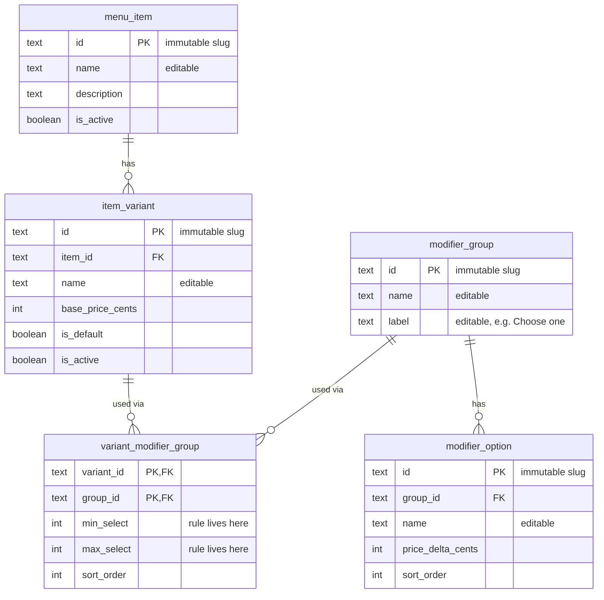

# Design — Feature 1: Display Taco Suave from a Database-Backed API

## Status
Approved for implementation task planning. Schema and SQL below are the agreed
design; actual creation/migration happens during the tasks, not in this document.
Menu prices in this document are current and restaurant-verified.

## Goal
Serve Taco Suave (name, base price in cents from its deterministic default variant,
and a required single-choice protein group with Steak and Chicken, carrying the
business rule *exactly one*) from PostgreSQL through a Node + Express + TypeScript
API, and display it in the existing React/Vite frontend with loading, error/retry,
and not-found states.

### Separating business rules from UI state (important)
- **Business rule (in the catalog):** a valid Taco Suave requires **exactly one**
  protein → `min_select = 1`, `max_select = 1`. Protein is **not** optional.
- **Temporary UI state (in React):** `selectedOptionId` starts at `null`, so nothing
  is visually pre-selected. This is a cosmetic starting point, not a rule.
- **Why no blocking here:** this feature is **display-only** — there is no submit
  button or order action to block. Enforcing "you must pick one before proceeding"
  happens in the later **cart/order** feature. The rule still exists today; it is
  simply not yet exercised by any submission.

---

## 1. Smallest relational schema (five-table catalog)

Five tables matching the team's planned structure. For *this* feature we only
populate Taco Suave, but the shape generalizes to the whole menu later.

### The tables and why each exists (beginner-friendly)
- **`menu_item`** — one row per dish (e.g. "Taco Suave").
- **`item_variant`** — a sellable version of an item; it carries the **price**. Each
  item designates exactly one **default variant** so a single-variant display is
  deterministic.
- **`modifier_group`** — a reusable, labeled set of choices (e.g. "Protein",
  display label "Choose one"). The group itself does **not** carry selection counts.
- **`modifier_option`** — one choice inside a group (e.g. "Steak", "Chicken"), with a
  `price_delta_cents` (change relative to base; 0 = no change).
- **`variant_modifier_group`** — the **join table** linking a variant to a group. It
  carries the **selection rules** (`min_select`, `max_select`) because the rules
  describe *how this particular variant uses the group* — the same group could be
  reused by another variant with different rules.

### Relationships in plain language
- A **menu item has one or more variants** (one-to-many); exactly one is the default.
- A **variant links to zero or more modifier groups** through `variant_modifier_group`
  (many-to-many), and **that link holds the selection rules** for that pairing.
- A **modifier group has one or more options** (one-to-many).
- So Taco Suave → its **default variant** → links to the "Protein" group **with
  min=1, max=1** → which has "Steak" and "Chicken".

> A **join table** connects two tables; each row says "A goes with B." Here it also
> stores *how* they go together (the min/max selection rules).

### IDs, names, and lifecycle rules
- **Text IDs are immutable primary keys** (stable slugs like `taco-suave`,
  `taco-suave-base`, `protein`, `steak`). Once assigned they never change, so the API
  and any references stay stable.
- **Display names are editable** (`name`, `label`) and are kept **separate** from IDs.
  Renaming "Steak" to "Carne Asada" changes only `name`, never the `steak` ID.
- **Archival over deletion (this feature: `menu_item` and `item_variant` only):**
  these two tables carry `is_active` (and variants an `is_default`). Their normal
  "removal" is **archival** — set `is_active = false` — so history and references
  survive, and the API simply stops returning inactive rows. Hard `DELETE` of such a
  row is an admin action, not something end users or the API do.
  `modifier_group` and `modifier_option` have **no `is_active` column in this
  feature**, so group/option archival is **out of scope here**; it can be added in a
  later feature if needed.
- **Cascading deletion is reserved for true owned-relationship rows, not applied
  indiscriminately:**
  - `modifier_option.group_id → modifier_group` : **CASCADE** (an option cannot exist
    without its group; deleting the group removes its options).
  - `variant_modifier_group.variant_id → item_variant` : **CASCADE** (the link is
    meaningless without its variant).
  - `variant_modifier_group.group_id → modifier_group` : **RESTRICT** (do not let
    deleting a shared group silently sever links; archive the group instead, or
    remove links explicitly first).
  - `item_variant.item_id → menu_item` : **RESTRICT** (don't let deleting an item
    quietly destroy priced variants; archive the item instead).

### Keys, types, and constraints (proposed)

**`menu_item`**
| column        | type    | constraints                     |
|---------------|---------|---------------------------------|
| `id`          | TEXT    | PRIMARY KEY, immutable (e.g. `taco-suave`) |
| `name`        | TEXT    | NOT NULL (editable display name)|
| `description` | TEXT    | NULL allowed                    |
| `is_active`   | BOOLEAN | NOT NULL DEFAULT TRUE           |

**`item_variant`**
| column            | type    | constraints                                                      |
|-------------------|---------|------------------------------------------------------------------|
| `id`              | TEXT    | PRIMARY KEY, immutable (e.g. `taco-suave-base`)                  |
| `item_id`         | TEXT    | NOT NULL, FK → `menu_item(id)` ON DELETE **RESTRICT**            |
| `name`            | TEXT    | NOT NULL (editable, e.g. `Base`)                                |
| `base_price_cents`| INTEGER | NOT NULL, CHECK (`base_price_cents` >= 0)                        |
| `is_default`      | BOOLEAN | NOT NULL DEFAULT FALSE                                           |
| `is_active`       | BOOLEAN | NOT NULL DEFAULT TRUE                                            |

**Enforcing "at most one active default per item"** (deterministic single variant):
- A **partial unique index** guarantees **at most one** *active default* per item —
  it rejects a *second* active-default row, but it does **not** force one to exist:
  ```sql
  CREATE UNIQUE INDEX one_active_default_per_item
    ON item_variant (item_id)
    WHERE is_default AND is_active;
  ```
  Because zero active defaults is still allowed by the database, the API must handle
  "active item with no active default" at read time — it returns **404** in that case
  (see sections 3 and 4). The index controls the *at-most-one* side; the *at-least-one*
  side is a catalog-readiness expectation enforced by seed data and verification, not
  by this constraint.

**`modifier_group`** (no min/max here — moved to the link table)
| column   | type | constraints                                        |
|----------|------|----------------------------------------------------|
| `id`     | TEXT | PRIMARY KEY, immutable (e.g. `protein`)            |
| `name`   | TEXT | NOT NULL (internal name, e.g. `Protein`)          |
| `label`  | TEXT | NOT NULL (display label, e.g. `Choose one`)       |

**`modifier_option`**
| column             | type    | constraints                                                   |
|--------------------|---------|---------------------------------------------------------------|
| `id`               | TEXT    | PRIMARY KEY, immutable (e.g. `steak`)                         |
| `group_id`         | TEXT    | NOT NULL, FK → `modifier_group(id)` ON DELETE **CASCADE**     |
| `name`             | TEXT    | NOT NULL (editable, e.g. `Steak`)                            |
| `price_delta_cents`| INTEGER | NOT NULL DEFAULT 0, CHECK (`price_delta_cents` >= 0)          |
| `sort_order`       | INTEGER | NOT NULL DEFAULT 0                                            |

**`variant_modifier_group`** (join table — now holds the selection rules)
| column        | type    | constraints                                                                 |
|---------------|---------|-----------------------------------------------------------------------------|
| `variant_id`  | TEXT    | NOT NULL, FK → `item_variant(id)` ON DELETE **CASCADE**                     |
| `group_id`    | TEXT    | NOT NULL, FK → `modifier_group(id)` ON DELETE **RESTRICT**                  |
| `min_select`  | INTEGER | NOT NULL DEFAULT 0, CHECK (`min_select` >= 0)                               |
| `max_select`  | INTEGER | NOT NULL DEFAULT 1, CHECK (`max_select` >= 1 AND `max_select` >= `min_select`) |
| `sort_order`  | INTEGER | NOT NULL DEFAULT 0                                                           |
| PRIMARY KEY   |         | (`variant_id`, `group_id`) — composite PK prevents duplicate links         |

> For Taco Suave's default variant ↔ Protein link: `min_select = 1`,
> `max_select = 1` (exactly one). The display label "Choose one" lives on the group.

**Constraint summary**
- **Primary keys:** every table (join table uses a composite PK).
- **Foreign keys:** per the lifecycle rules above — CASCADE only for truly owned rows
  (`modifier_option→group`, `variant_modifier_group→variant`), RESTRICT for shared or
  priced parents (`item_variant→item`, `variant_modifier_group→group`).
- **Partial unique index:** at most one active default variant per item.
- **CHECK:** non-negative prices/deltas; `max_select >= min_select` and `>= 1`.
- **NOT NULL:** names, labels, prices, selection rules, all foreign keys.

---

## 2. ER diagram (Mermaid)

The cardinalities below reflect what the **database actually enforces**. A foreign
key only requires a child to point at an existing parent; it never forces a parent to
have any children. So every parent side is "zero or more" (`o{`). The stronger
"a real menu item should have a variant, a usable group should have options" statements
are **catalog-readiness rules** (satisfied by seed data and checked in verification),
not database constraints — they are listed separately after the diagram.



**Cardinality check — database constraints (what the diagram shows)**
- `menu_item ||--o{ item_variant` — a variant's `item_id` is NOT NULL and must
  reference an existing item (the child *must* have a parent). The database allows an
  item with **zero** variants, so the parent side is "zero or more."
- `item_variant ||--o{ variant_modifier_group` and
  `modifier_group ||--o{ variant_modifier_group` — the join table resolves a
  many-to-many; each parent can have **zero or more** links.
- `modifier_group ||--o{ modifier_option` — an option's `group_id` is NOT NULL and
  must reference an existing group; a group may have **zero** options as far as the
  database is concerned.

**Catalog-readiness rules (NOT enforced by the schema; satisfied by seed data and
checked in verification)**
- A sellable menu item should have **at least one** active variant, and **exactly one**
  active default (the database enforces only the *at-most-one* half, via the partial
  unique index).
- A usable modifier group should have **at least one** option.
- These are expectations about well-formed catalog content, not column constraints —
  the schema deliberately does not block an in-progress, not-yet-complete item.

### Example rows — Taco Suave with Steak & Chicken

`menu_item`
| id         | name       | description                | is_active |
|------------|------------|----------------------------|-----------|
| taco-suave | Taco Suave | Soft corn tortilla taco... | true      |

`item_variant`
| id              | item_id    | name | base_price_cents | is_default | is_active |
|-----------------|------------|------|------------------|------------|-----------|
| taco-suave-base | taco-suave | Base | 525              | true       | true      |

`modifier_group`
| id      | name    | label      |
|---------|---------|------------|
| protein | Protein | Choose one |

`modifier_option`
| id      | group_id | name    | price_delta_cents | sort_order |
|---------|----------|---------|-------------------|------------|
| steak   | protein  | Steak   | 0                 | 1          |
| chicken | protein  | Chicken | 0                 | 2          |

`variant_modifier_group`
| variant_id      | group_id | min_select | max_select | sort_order |
|-----------------|----------|------------|------------|------------|
| taco-suave-base | protein  | 1          | 1          | 1          |

> `525` cents ($5.25) is the current, restaurant-verified base price; the protein
> options carry a `0` delta (no upcharge). The `min=1,max=1` row encodes the real
> "exactly one protein" rule.

---

## 3. API route and example response

### Route
`GET /api/menu/items/:itemId` — called as `GET /api/menu/items/taco-suave`.

### Success response (HTTP 200)
```json
{
  "id": "taco-suave",
  "name": "Taco Suave",
  "description": "Soft corn tortilla taco with lettuce, cheese, and pico de gallo.",
  "variantId": "taco-suave-base",
  "basePriceCents": 525,
  "modifierGroups": [
    {
      "id": "protein",
      "label": "Choose one",
      "minSelect": 1,
      "maxSelect": 1,
      "options": [
        { "id": "steak",   "name": "Steak",   "priceDeltaCents": 0 },
        { "id": "chicken", "name": "Chicken", "priceDeltaCents": 0 }
      ]
    }
  ]
}
```

- **Stable IDs:** `id`, `variantId`, group `id`, option `id` are the immutable DB
  primary keys.
- **Variant:** `variantId` + `basePriceCents` come from the **single active default
  variant** only.
- **Selection rules:** `minSelect: 1, maxSelect: 1` (from the join row) encode
  "exactly one — required."
- **Price deltas:** `priceDeltaCents` per option (0 here).

### Not-found response (HTTP 404)
Returned when the item is missing/inactive **or** when an active item has **no active
default variant** (we never guess a variant):
```json
{ "error": "item_not_found", "itemId": "taco-suave" }
```

### Server error (HTTP 500)
```json
{ "error": "internal_error" }
```

---

## 4. From database rows → API JSON → React display

### Data flow
```
PostgreSQL (Supabase)
   │  parameterized SQL (JOINs across the 5 tables, default variant only)
   ▼
Express + TypeScript route handler  (shapes rows into the JSON above)
   ▼
HTTP GET /api/menu/items/taco-suave  (JSON over the network)
   ▼
React component (loading / error / not-found / success)
   ▼
Browser screen
```

### Backend read — deterministic default variant (proposed query, for review)
We first resolve the **single active default variant**, then join only that variant's
groups/options — so fields from different variants can never be combined:

```sql
WITH default_variant AS (
  SELECT iv.id, iv.item_id, iv.base_price_cents
  FROM item_variant iv
  JOIN menu_item mi ON mi.id = iv.item_id AND mi.is_active
  WHERE iv.item_id = $1
    AND iv.is_default
    AND iv.is_active
  LIMIT 1               -- partial unique index guarantees at most one; LIMIT is a guard
)
SELECT mi.id   AS item_id, mi.name AS item_name, mi.description,
       dv.id   AS variant_id, dv.base_price_cents,
       mg.id   AS group_id, mg.label, vmg.min_select, vmg.max_select, vmg.sort_order AS group_sort,
       mo.id   AS option_id, mo.name AS option_name, mo.price_delta_cents, mo.sort_order AS option_sort
FROM default_variant dv
JOIN menu_item mi ON mi.id = dv.item_id
LEFT JOIN variant_modifier_group vmg ON vmg.variant_id = dv.id
LEFT JOIN modifier_group mg          ON mg.id = vmg.group_id
LEFT JOIN modifier_option mo         ON mo.group_id = mg.id
ORDER BY vmg.sort_order, mo.sort_order;
```

Handler logic:
- If the `default_variant` CTE yields **no row** → the item is missing/inactive, or
  active-but-has-no-active-default → respond **404 `item_not_found`** (never fabricate
  or merge another variant).
- Otherwise collapse the flat rows into nested JSON (one item → default variant →
  groups → options), mapping `min_select/max_select` → `minSelect/maxSelect` and
  `price_delta_cents` → `priceDeltaCents`.
- On a thrown query/DB error → respond **500 `internal_error`**.
- `$1` is a **parameter** (parameterized SQL), preventing SQL injection.

### Frontend shape (proposed)
Replace the existing static Taco Suave row with a small component — e.g.
`src/components/TacoSuaveCard.jsx` — that:
1. On mount, `fetch("/api/menu/items/taco-suave")`.
2. Tracks `status` = `loading | success | error | notFound`, plus `data` and
   `selectedOptionId` (initially `null` → UI starts empty; this is temporary UI
   state, independent of the exactly-one business rule).
3. Renders by `status` (section 6/7).
4. Formats `basePriceCents` for display only (`(cents / 100).toFixed(2)`).
5. Renders the protein group as **radio inputs** (`<input type="radio" name="protein">`)
   so the browser enforces at-most-one and replace-on-change; none checked initially.
   The group shows its "Choose one" label; because this is display-only, no blocking
   validation runs here.

> In local dev, the Vite dev server proxies `/api/*` to Express so the frontend calls
> a relative URL. (Proxy config is an implementation detail for later.)

---

## 5. Loading, error, retry, and not-found behavior

| State        | Trigger                                         | UI shown                                                      |
|--------------|-------------------------------------------------|--------------------------------------------------------------|
| **Loading**  | request in flight                               | Loading indicator; no stale/empty item (AC6)                 |
| **Success**  | HTTP 200 with item JSON                         | Name, base price, "Choose one" group with Steak/Chicken radios (AC5, AC9-AC12) |
| **Error**    | network failure or HTTP 500 (non-404)           | Friendly message + **Retry** button that re-runs the fetch (AC7) |
| **Not found**| HTTP 404 (`item_not_found`, incl. no active default) | "This item is currently unavailable"; no crash (AC8)    |

Retry re-enters Loading and repeats the request. Not-found is a distinct,
non-retryable-by-default outcome, separate from a transient error.

---

## 6. Where the component appears — Option B, in place (no double display)

**Confirmed repo fact:** `src/App.jsx` renders the whole menu by looping over the
hard-coded `src/data/menu.js`; Taco Suave is the **first item** in the "Original
Tacos" category.

**Decision: Option B.** Replace Taco Suave **in its existing position** in the
"Original Tacos" list with the API-backed `TacoSuaveCard`. We do **not** add any
customer-facing "live from our menu service" section.

To replace it precisely and avoid a double render, give the static entry a **stable
identifier** so the render loop can detect and swap exactly that one row:
- Add a stable field to the Taco Suave entry in `menu.js`, e.g. `id: "taco-suave"`
  (matching the catalog ID). This is a frontend marker for the swap, not catalog data.
- In the "Original Tacos" mapping, when an item's `id === "taco-suave"`, render
  `<TacoSuaveCard />` in that slot instead of the static row; all other items render
  from static data unchanged.

Result: exactly one Taco Suave, in its original place, now sourced from the API
(AC16, AC17).

---

## 7. Keeping database credentials on the backend

- The **Supabase/PostgreSQL connection string and any Supabase service key live only
  on the Express server**, loaded from server-side environment variables (a
  git-ignored `.env`). They are never imported into frontend code.
- The **frontend only calls the relative API URL** and receives plain menu JSON —
  never SQL, never a connection string, never a key (AC15).
- Vite inlines any `VITE_`-prefixed variable into the browser bundle, so database
  secrets must **not** use that prefix and must **not** live in any frontend env file.
  Only the Express process reads DB credentials.
- `.gitignore` must cover the backend `.env`. (The repo already has a `.gitignore`;
  we'll confirm backend env files are included when we scaffold.)
- **One shared Supabase development project** is used for this feature. The database
  schema is defined by **version-controlled SQL migration files** in the repo (plain
  `.sql`, applied in order), so the structure is reproducible and reviewable — not
  clicked together by hand.
- **The catalog tables are never exposed for direct public writes.** The browser only
  talks to our read-only Express endpoint. The database is reached using a
  **server-side-only** credential; the public/anon Supabase key is **not** used by the
  frontend to read or write the catalog. If Supabase Row Level Security is enabled,
  policies must not grant anonymous insert/update/delete on the catalog tables.

---

## 8. Verification plan (proving data comes from PostgreSQL)
All changes confined to **development data** in the shared dev Supabase project
(editing seed rows only, never schema); revert each change after the check.

1. **Row-change test (strongest proof).** Change `menu_item.name` for `taco-suave`
   in the dev DB (e.g. "Taco Suave (DB test)"), reload the frontend, confirm the name
   changes with **no code edit/redeploy**. Revert.
2. **Price-change test.** Update the default variant's `base_price_cents`
   (e.g. `525` → `599`) in dev; confirm the displayed price updates on reload. Revert.
3. **Option-change test.** Temporarily add a third `modifier_option` to `protein` in
   dev; confirm a third radio appears; delete it; confirm it disappears.
4. **Selection-rule test.** Confirm the API returns `minSelect: 1, maxSelect: 1` for
   the default variant↔protein link (sourced from `variant_modifier_group`).
5. **Default-variant test.** With a second variant present but `is_default = false`,
   confirm the response still reflects only the default (no merged fields). Then set
   the default's `is_active = false` and confirm the API returns **404** (active item,
   no active default). Revert.
6. **No-hard-coding grep.** Confirm the Express route builds its response from query
   results, with no literal `"Taco Suave"` / `525` as the response source.
7. **Not-found path.** `GET /api/menu/items/does-not-exist` → HTTP 404
   `item_not_found`; UI shows the unavailable state.
8. **Error path.** Temporarily point the server at an unreachable DB (or stop it);
   confirm the frontend shows error + Retry, and Retry recovers once restored.
9. **Secret-leak check.** Inspect the frontend bundle / network tab; confirm no
   connection string or Supabase key is present — only menu JSON.

---

## Explicitly out of scope (future features)
Cart, checkout, pricing math, order submission, payment, loyalty, customer accounts,
authentication, admin editing, and Clover Station Duo / kitchen-printer integration.
Clover integration will be investigated separately and early, but no Clover calls are
part of this feature. Submission-time enforcement of the exactly-one protein rule is
deferred to the cart/order feature (the rule itself is defined now, in the catalog).

## Next step
Implementation is organized in `tasks.md` (same folder). Database schema creation,
SQL migrations, package installation, and application code happen there, in small
dependency-ordered tasks — not in this document.
